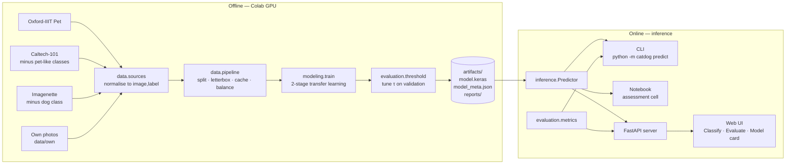

# Architecture

## 1. Goal and constraints

| Requirement (from the brief) | Design response |
|---|---|
| Sort a folder into **dog / cat / neither** | 3-way softmax + a tuned "animal threshold" safety net |
| "Neither" must not be a forced guess | Trained `neither` class from *diverse* negatives (Approach A); Approach B measured and documented |
| Any size, shape, format | One hardened loader (`image_io`) used by **both** training (own photos) and inference |
| Saved model, no retraining on the day | `model.keras` + `model_meta.json` artifact pair; `Predictor.load()` |
| One cell, change one line | `predict_folder_table(FOLDER)` |
| Runs after restart | Notebook `TRAIN = False` switch; CLI runs in a fresh process |
| Own confusion matrix | `catdog evaluate data/holdout`, plus the live Evaluate tab in the UI |

## 2. System overview



**Separation of concerns**

| Layer | Package | Depends on | Never depends on |
|---|---|---|---|
| Config | `catdog.config` | — | everything |
| Shared preprocessing | `catdog.preprocessing` | TF | data, server |
| Data | `catdog.data.*` | config, preprocessing, image_io, TFDS | server, modeling |
| Model + training | `catdog.modeling.*` | data, evaluation | server |
| Inference | `catdog.inference.*` | config, preprocessing | data, TFDS, training |
| Metrics | `catdog.evaluation.metrics` | NumPy only | TF (so the API stays light) |
| Serving | `catdog.server.*` | inference, metrics | data, training |
| Presentation | `web/` | HTTP API only | Python |

The inference path has **no dependency on the training stack** — the server and the Docker image ship without
`tensorflow-datasets`, and the web front-end only knows the HTTP contract.

## 3. The single-source-of-truth rules

These rules exist because each one prevents a classic "works in the notebook, fails on the day" bug:

1. **One resize function** (`preprocessing.resize_for_model`) for training and inference. Letterbox, not squash or
   crop, so portrait phone photos keep the whole animal in frame.
2. **Pixel scaling lives inside the model** (the backbone's own preprocessing layer). Callers send raw 0–255 RGB and
   cannot forget to normalise.
3. **One image loader** (`inference.image_io.load_image`): EXIF rotation, RGBA→white, greyscale/16-bit/CMYK→RGB,
   first GIF frame, HEIC, early down-scaling of 12 MP photos, decompression-bomb guard.
4. **One decision function** (`inference.predictor.decide`) used by the Predictor *and* by threshold tuning, so the
   tuned τ means exactly the same thing at inference.
5. **One metrics module** used by training reports, the CLI and the `/api/evaluate` endpoint — the confusion matrix in
   the UI and the one in your report cannot disagree.
6. **Model + metadata travel together.** `model_meta.json` stores labels, image size, τ, TTA flag, data counts,
   exclusions, validation metrics and library versions. `Predictor.load` refuses a model whose labels disagree with the code.

## 4. The "neither" strategy

```
softmax(cat, dog, neither) ──► arg-max ──► if arg-max ∈ {cat, dog} and max(p_cat, p_dog) < τ ──► "neither"
```

* **Approach A** gives the model an explicit way to say "not a pet". Its quality is bounded by the negative set, so
  negatives are mixed for *diversity*: Caltech-101 (objects, plain backgrounds), Imagenette (real scenes, clutter) and the
  student's own photos of Nigerian surroundings (people, food, okada, chickens, rooms). Per-source caps
  (3,000 each) stop any one source from defining what "neither" looks like.
* **τ (safety net)** is swept on validation data and the value with the best macro-F1 is kept (lowest among ties, to
  override the model as little as possible).
* **Approach B** is implemented as an experiment (`train --two-class`) and its threshold study is saved to
  `artifacts/reports/approach_b.json` and shown on the Model card. It is the evidence for choosing A.
* **Exclusions** (`data/exclusions.py`) remove anything that would teach "a dog is not a dog": `dalmatian`, cartoon
  `snoopy`/`garfield`, `wild_cat`, unlabelled `background_google`, Imagenette's springer spaniel. Unknown names raise an
  error, so a typo cannot silently let a dog breed through.

## 5. Model

* Backbone: **EfficientNetV2-B0**, ImageNet weights (`mobilenetv3large`, `efficientnetv2b1` selectable).
* Head: global average pool → dropout 0.3 → dense softmax (3).
* Augmentation layers in-model (inactive at inference): flip, rotation, zoom-out, translation, **brightness and
  contrast** (simulating dim indoor phone photos — the brief's biggest warning).
* Training: stage 1 frozen backbone (lr 1e-3), stage 2 fine-tune top 40 layers with BatchNorm frozen (lr 1e-5);
  label smoothing 0.05 (less over-confidence → more useful threshold); inverse-frequency class weights; early stopping on
  val loss with best-weights restore.
* Inference: horizontal-flip test-time augmentation (also applied when tuning τ).

## 6. Data pipeline

```
tfds (encoded bytes) ─ shuffle(seed) ─ filter(exclusions) ─ take(limit) ─ decode ─ split(i % 20 < 3 → val)
   ─ letterbox → uint8 ─ cache(disk, keyed by config hash) ─ per-source shuffle ─ sample_from_datasets(∝ size) ─ batch
```

* Shuffling *before* decoding is cheap and makes `--limit 50` a varied sample.
* Deterministic split by index after a seeded shuffle: same images in val every run.
* Cache key hashes image size, seed, limit, split and exclusion lists — changing any of them can never reuse a stale cache.
* Validation always contains all three classes, even in the two-class experiment, so "neither" is always measured.

## 7. Serving

* **FastAPI** app, model loaded once in the lifespan hook; failure to load is *not* fatal — `/api/health` reports
  `no_model` and the UI shows a banner with the reason and a *Reload model* button (`POST /api/model/reload`).
* Inference runs in a worker thread behind a lock: the event loop stays responsive and TensorFlow is never entered concurrently.
* Uploads: non-image files are skipped (dropped folders contain `.DS_Store`), size/count limits via env vars
  (`CATDOG_MAX_FILES`, `CATDOG_MAX_FILE_MB`), unreadable images come back as `error` rows rather than failing the batch.
* GZip and a `Server-Timing` header for observability; OpenAPI docs at `/docs`.
* Docker image (`Dockerfile`) runs as a non-root user with a health check.

## 8. Front-end

Dependency-free ES modules (no build step — works offline on assessment day):

```
web/
  index.html            semantic shell, inline SVG icon sprite
  assets/styles.css     design tokens (light/dark), components, responsive rules
  assets/app.js         bootstrap: tabs, theme, status polling
  assets/js/api.js      the only module that talks HTTP
  assets/js/store.js    tiny observable store (state + topics)
  assets/js/util.js     DOM, formatting, tooltip, drag-and-drop folder walking
  assets/js/views/      classify.js · evaluate.js · model-card.js
```

* **Classify**: drop files *or whole folders*; chunked uploads with progress; three "pile" tiles; grid or table;
  filter by pile / unsure / mistakes; per-image probability bar with tooltip; true-label tagging (auto-detected from
  `cat/`, `dog_03.jpg`, `neither/` …); CSV export; "copy table" in the brief's exact format.
* **Evaluate**: confusion matrix (rows = true, columns = predicted, as on the board), accuracy, per-class precision
  and recall shown as fractions (`4/6`) for hand-checking, clickable cells listing the photos behind each number.
* **Model card**: approach, threshold, training data by source, macro-F1 vs threshold chart, Approach B evidence,
  exclusion list with reasons.
* Colour: categorical slots fixed per class (cat blue, dog orange, neither aqua) and always paired with a text label;
  a single-hue sequential ramp for the matrix; status colours (right/wrong) always with an icon. Light and dark themes,
  keyboard focus styles, `prefers-reduced-motion` and `forced-colors` support.

## 9. Testing

`pytest` covers: the loader on huge/transparent/greyscale/16-bit/CMYK/EXIF-rotated/corrupt images; the metrics against a
hand-worked board example; the decision policy and threshold study; save → reload → predict with a real Keras file; and
the HTTP API including the no-model degraded mode.

## 10. What it would take to deploy for real

* A monitored hold-out set from the *deployment* cameras, re-measured on every model version.
* Calibration (temperature scaling) so "94%" means right ~94% of the time.
* A choice of operating point driven by cost: for a "dog loose on the property" alarm, false alarms on empty rooms are the
  costly error, so τ would be raised and "neither" precision traded for dog precision.
* Model versioning (meta already stores versions and data counts), request logging of low-confidence cases for review,
  auth and rate limiting on the API, and a GPU or a smaller backbone (MobileNetV3) depending on latency targets.
